# 功能演示

每个功能提供 GIF 与 MP4。完整本地预览见 [演示画廊](index.html)。

这些是实际网页操作截图组成的无声步骤动画，非连续实时录屏。画面使用测试工程，无私人录音或 API Key。字幕与进度条为后期添加。

## 逐字边界精修

选择一个字，查看波形并调整字尾。

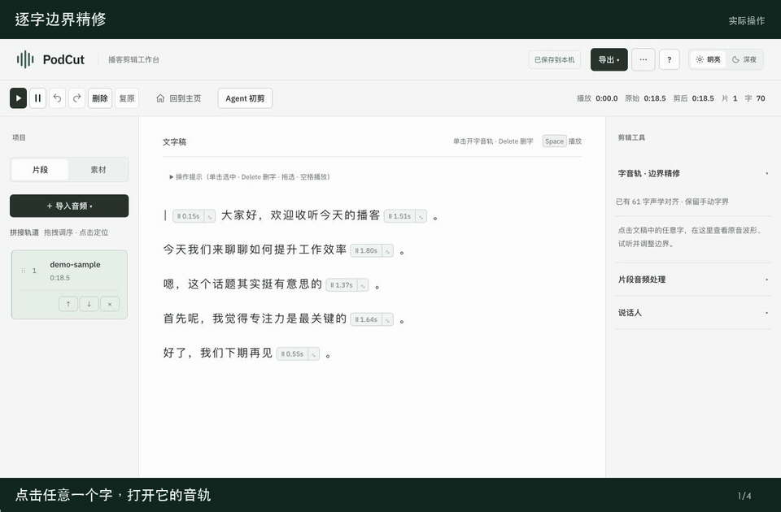

[MP4](01-word-boundary.mp4) · [GIF](01-word-boundary.gif)

## 删字同步剪音频

删除口头语，再撤销恢复。

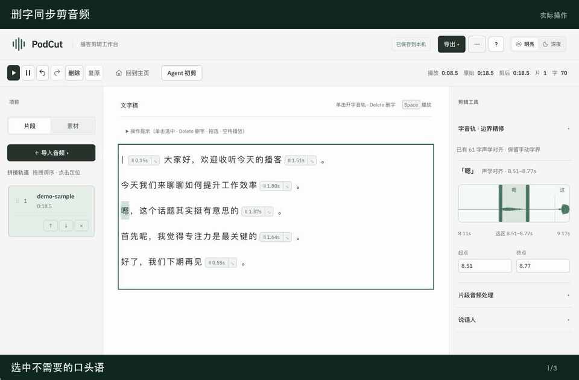

[MP4](02-text-edit.mp4) · [GIF](02-text-edit.gif)

## 停顿删除与复原

查看停顿边界，整处剪除或恢复。

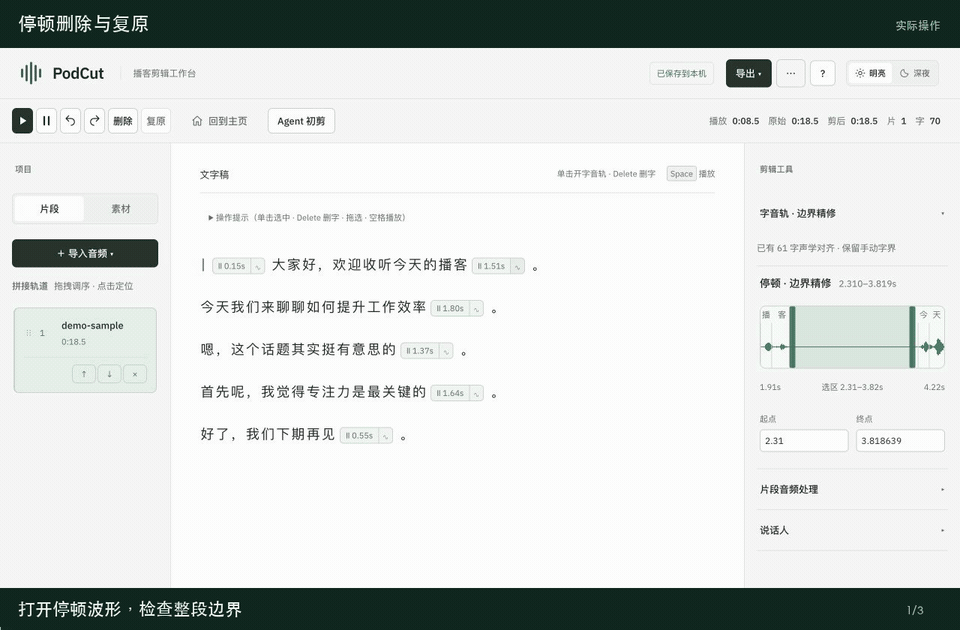

[MP4](03-pause.mp4) · [GIF](03-pause.gif)

## 背景音乐与先行

调整已放入工程的背景音乐，设置先行时间并定位结束处。

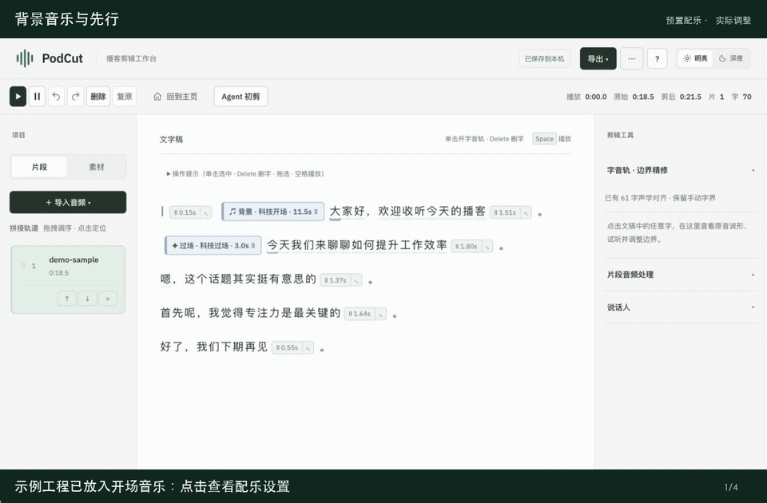

[MP4](04-background.mp4) · [GIF](04-background.gif)

## 过场音乐与衔接

调整已放入工程的过场长度，查看下一句话的衔接位置。

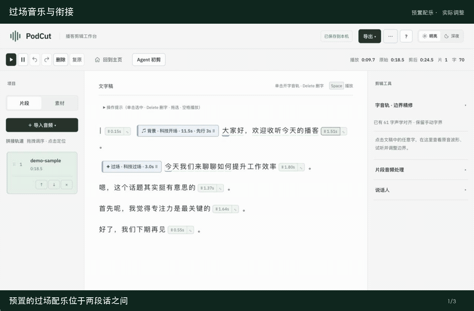

[MP4](05-transition.mp4) · [GIF](05-transition.gif)

## 人声独立倍速

设置 1.1 倍人声速度，配乐时长保持原样。无声演示不用于音质判断。

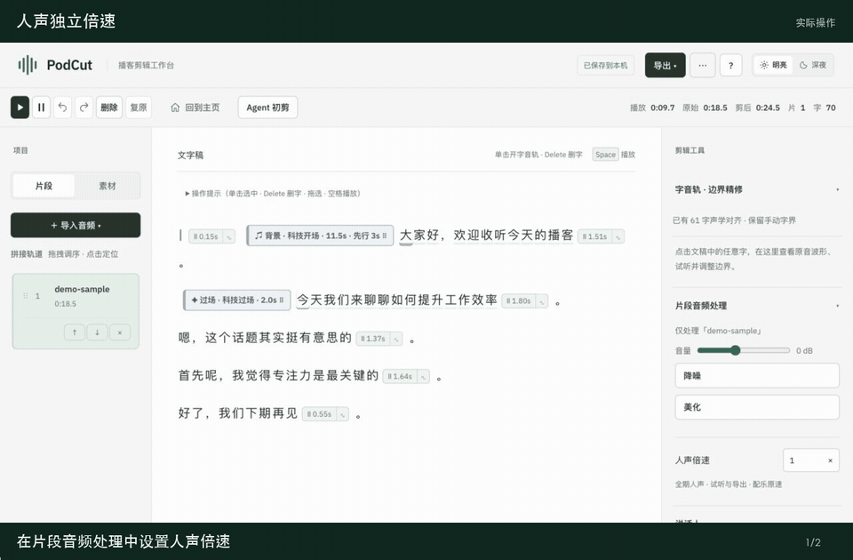

[MP4](06-voice-speed.mp4) · [GIF](06-voice-speed.gif)

## Agent 初剪配置

参考稿、吸气、精句选择、片头背景、过场和片尾设置。未调用 AI。

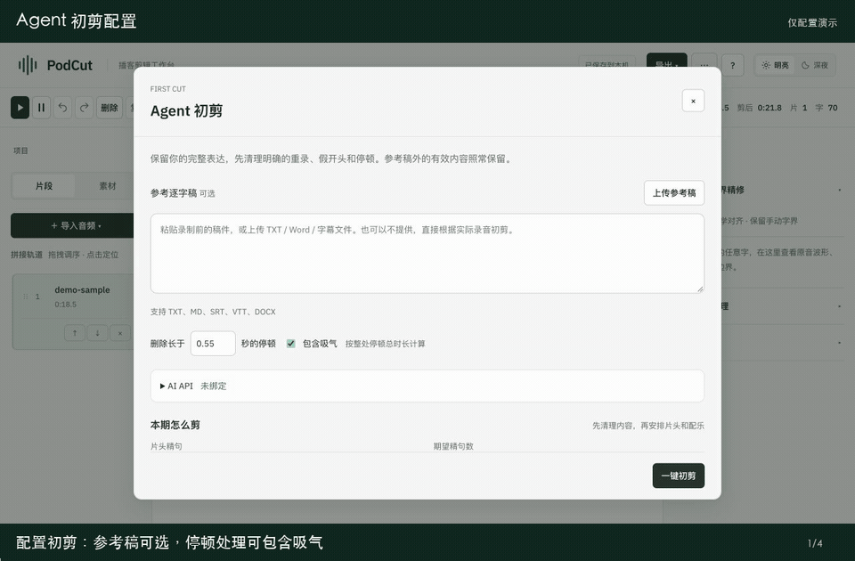

[MP4](07-agent.mp4) · [GIF](07-agent.gif)

## 历史剪辑与自动保存

回到主页、搜索工程、继续编辑。

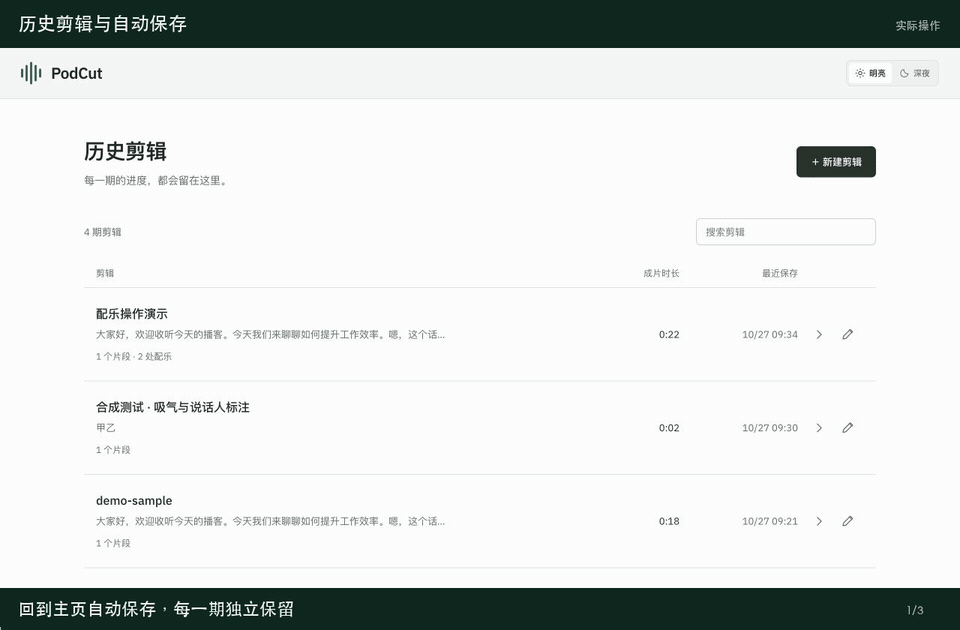

[MP4](08-history.mp4) · [GIF](08-history.gif)

## 音频与节目材料导出

展示导出入口，并实际完成本机音频导出。长文稿与简介未生成。

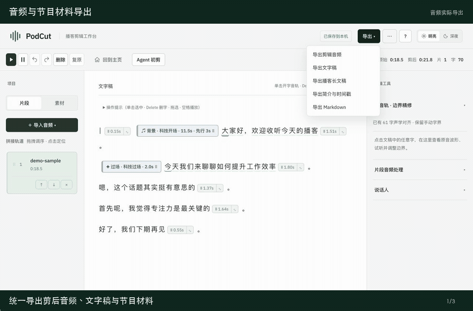

[MP4](09-export.mp4) · [GIF](09-export.gif)

## 吸气纳入停顿

使用音调与噪声构造的测试样本，演示非静音间隔随整处停顿剪除。不是实际呼吸录音或准确率评测。

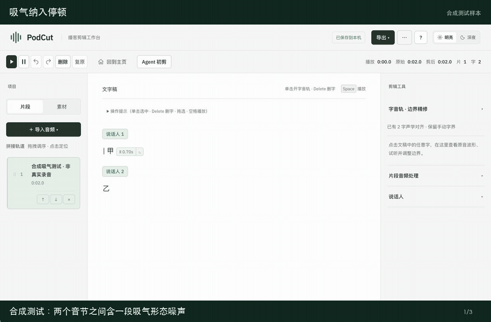

[MP4](10-breath.mp4) · [GIF](10-breath.gif)

## 多人说话人标签

预先准备两位说话人的标签，实际修改为主持人和嘉宾。未调用自动识别。

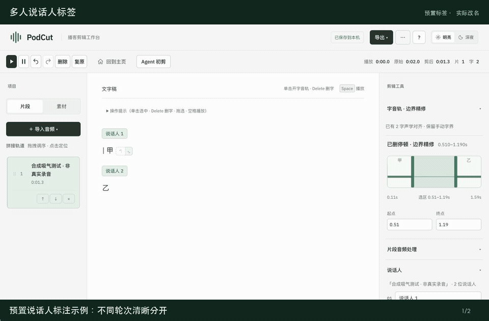

[MP4](11-speakers.mp4) · [GIF](11-speakers.gif)

## 明亮与深夜

切换界面主题，保持编辑布局。

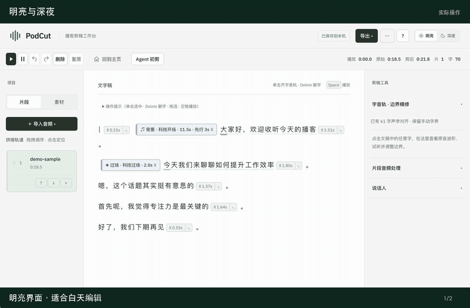

[MP4](12-theme.mp4) · [GIF](12-theme.gif)

## 录音与素材导入入口

两个素材栏均展示本地文件和 URL 导入入口。此片段未执行 URL 下载或转写。

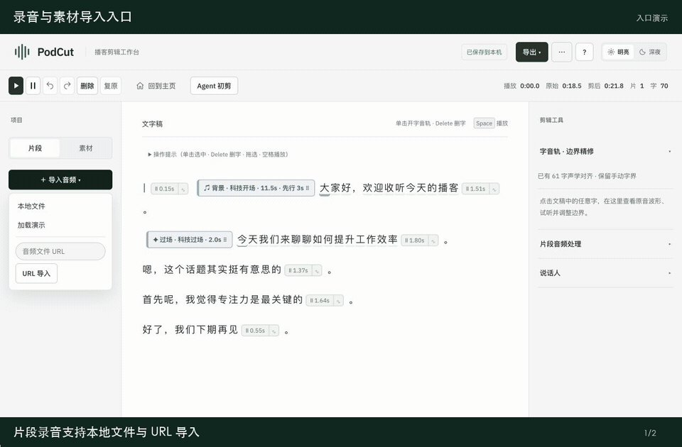

[MP4](13-import.mp4) · [GIF](13-import.gif)
